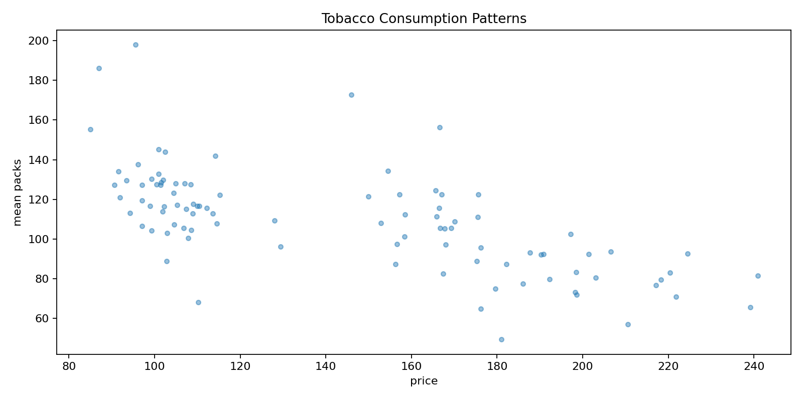

# Tobacco Consumption Patterns — executed results

## Decision question
How are cigarette prices and recorded per-capita packs associated?

## Evidence
Among 96 complete observations, Pearson r = -0.652 and Spearman rho = -0.732.

Raw rows: 96. Rows used: 96. Excluded for missing/nonfinite required values or invalid denominator: 0.

## Method
Complete-pair scatter plot of price and packs, with Pearson and Spearman correlations. No regression adjustment or causal claim.

## Interpretation and limitations
Repeated states and two historical periods; nominal prices and policy confound associations. No causal inference, significance claim or production deployment is implied. Missing values are not imputed; identical rows are retained. Small or repeated samples limit uncertainty interpretation.

## Recommended next decision
Deflate prices and use a panel design before estimating elasticities.

## Reproducibility
Source and exact downloaded-byte SHA256 are recorded in run_manifest.json. SQL results are in answer.csv and analysis.sqlite. Review quality_audit.csv before interpretation.
